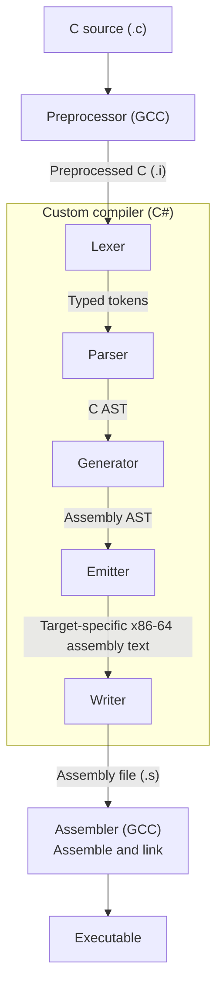

# Compiler architecture

The implementation follows the book's progression from parsing C source through semantic analysis and code generation, with the goal of making each compiler stage clear, testable, and easy to extend.

## Current scope

The custom compiler completes chapter one: a single `int` function with
`void` parameters and one statement returning an integer constant, such as:

```c
int main(void)
{
    return 2;
}
```

The custom compiler rejects syntax outside this grammar, missing tokens, and
trailing tokens. Later chapters' language features are not implemented yet.

## Pipeline

The compiler pipeline is:



Each stage has one job:

1. `Preprocessor` uses GCC to preprocess the C source.
2. `Lexer` returns the typed tokens defined in `Token.cs`.
3. `Parser` returns the C AST defined in `C.cs` and described in [c-ast.md](c-ast.md).
4. `Generator` lowers the C AST to the assembly AST in `Assembly.cs`, described in [asm-ast.md](asm-ast.md).
5. `Emitter` accepts a `CompilationTarget` (`Mac` or `Linux`) and returns the
   corresponding x86-64 assembly text. Mac symbols have an underscore prefix;
   Linux symbols keep their C names, and Linux output includes a
   `.note.GNU-stack` section to mark the stack as non-executable.
6. `Writer` saves the assembly to a `.s` file.
7. `Assembler` uses GCC to assemble and link the executable.

`Driver` selects `CompilationTarget.Mac` when running on macOS and
`CompilationTarget.Linux` when running on Linux. Other operating systems are
rejected before GCC is invoked. Both targets generate x86-64 code. The GCC
helpers add `-arch x86_64` on macOS; Linux uses the native x86-64 GCC toolchain.

The mutually exclusive stage flags stop after lexing (`--lex`), parsing
(`--parse`), assembly AST generation (`--codegen`), or writing assembly (`-S`).
The first three produce no output files; `-S` leaves a `.s` file without
assembling or linking. Every mode removes the preprocessed `.i` file.

## C# namespaces

`Lexer`, `Parser`, `Generator`, `Emitter`, and token types use the global namespace.
The C AST and assembly AST live in `src/Syntax/` and use `Syntax.C` and `Syntax.Assembly`.
The GCC stages (`Preprocessor` and `Assembler`), `Writer`, `ExitCode`, and
`CompilationTarget` live in `src/Helpers/` and use `Helpers`. Tests use
`CompilerIntegrationTests`.
`Driver.cs` constructs command-line options in a static method and orchestrates
the compiler pipeline, including preprocessing-file cleanup and compiler diagnostics.

See the [README usage instructions](../README.md#usage) for compiler options
and examples.
