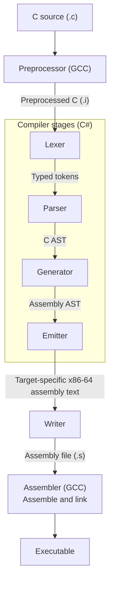

# Compiler Architecture

## Scope

The compiler completes chapter one of *Writing a C Compiler*. It accepts a single `int` function with `void` parameters that returns an integer constant.

```c
int main(void) {
    return 2;
}
```

The parser rejects missing or trailing tokens and syntax outside the [C grammar](c-grammar.md).

## Pipeline

The compiler implements four stages. It uses `gcc` to preprocess the C source and to assemble and link the generated assembly.



1. **Lexing.** Reads preprocessed C and produces [typed tokens](../src/Token.cs). [Lexer](../src/Lexer.cs)
2. **Parsing.** Builds the [C AST](c-syntax.md) from the tokens. [Parser](../src/Parser.cs)
3. **Code generation.** Lowers the C AST to the [assembly AST](assembly-syntax.md). [Generator](../src/Generator.cs)
4. **Assembly emission.** Turns the assembly AST into x86-64 assembly text for the selected target. [Emitter](../src/Emitter.cs)

## Driver

[Driver.cs](../src/Driver.cs) defines the command-line options and runs the pipeline.

- **Paths.** Passes absolute paths to GCC so a source filename like `@file.c` is treated as a path.
- **Diagnostics.** Catches `Helpers.Error` from the lexer or parser and prints `Error: <message>`.
- **Temporary files.** Keeps the `.i` file and the `.s` file from a full compilation in a private temporary directory. Removes the directory when compilation finishes.

### Stage flags

Use one stage flag per run. The compiler writes any final output beside the source file.

| Flag | Stops after | Output file |
| --- | --- | --- |
| `--lex` | Lexing | None |
| `--parse` | Parsing | None |
| `--codegen` | Code generation | None |
| `-S` | Writing assembly | `.s` file |
| None | Assembling and linking | Executable |

## Targets

The driver selects the x86-64 target based on the host operating system. It checks for a supported host before invoking GCC.

| Host | Target | Assembly | GCC |
| --- | --- | --- | --- |
| macOS (Intel or Apple Silicon) | `Target.Mac` | Leading underscore on symbols | Adds `-arch x86_64` |
| Linux (x86-64) | `Target.Linux` | Uses C symbol names and adds `.note.GNU-stack` to mark the stack as non-executable | Uses the native toolchain |

See [Quick Start](../README.md#quick-start) for build and run examples.

## C# Namespaces

| Namespace | Types |
| --- | --- |
| Global | `Lexer`, `Parser`, `Generator`, `Emitter`, and token types |
| `Syntax.C`, `Syntax.Assembly` | C and assembly AST types in [Syntax.cs](../src/Syntax.cs) |
| `Helpers` | `Preprocessor`, `Assembler`, `GCC`, `Writer`, `Error`, `ExitCode`, and `Target` in [src/Helpers](../src/Helpers) |
| `CompilerIntegrationTests` | Test classes in [tests](../tests) |
